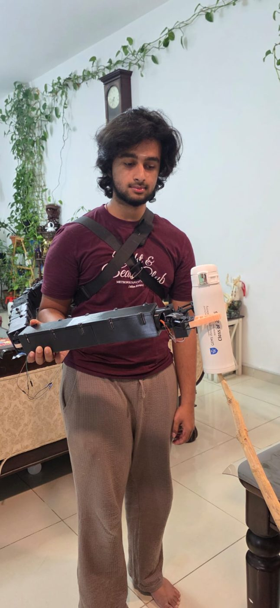

# Timeline

Project Arachnae day by day: what I did, what I decided and why, and what happened.

**Sources.** From September 2026 on, this comes from my working logs, test logs and changelogs. Before that, my notes
are thin, so those months are reconstructed from the dates on my CAD files, code, photos and GitHub commits; I've kept
those entries to what the files show. The repo itself was reorganised and pushed on 2026-10-08, so commit dates are not
the dates the work was done; this file is.

- [V1: November 2025 to April 2026](#v1-november-2025-to-april-2026)
- [V2 design: May to August 2026](#v2-design-may-to-august-2026)
- [September 2026: bring-up](#september-2026-bring-up)
- [October 2026: the base, vision and the demo](#october-2026-the-base-vision-and-the-demo)

---

## V1: November 2025 to April 2026

V1 was an Arduino Uno R4 WiFi arm: a NEMA 23 stepper (TB6600 driver) on the base, DS3218 servos on the arm segments
and MG996R servos pulling rubber-band tendons in a five-finger hand, through a PCA9685 servo board.

### November 2025
- **Nov 8:** first base design: a segment with 20T/60T spur gears (`cad/v1/iteration_1/Base_segment_1_spur_gear_v5.step`).
- **Nov 23:** first printed base casing (`cad/v1/print_plates/V1_base_casing_early.3mf`).

### December 2025
- **Dec 5:** base redesigned around a NEMA 23 stepper driving a turntable through pulleys (`Base_NEMA23_turntable_v2.step`).
- **Dec 10–16: iteration 2.** Base casing, cover and bushing, stepper motor case and pulley gear, bevel gear cover,
  turntable, shoulder driving gears, a tendon lock, a servo lock, and a printed base belt.
- **Dec 17–22: iteration 2.5 begins.** New base casing (v2.5), shoulder gears and pulley, the bicep sections (bottom,
  middle, top) with covers, and lettering for the arm.
- **Dec 24–26:** forearm pulley and printed forearm belt.
- **Dec 30–31:** the tendon-driven hand: finger, finger mount v2.5, hand mount v2, pulley assembly, tensioner,
  bearing cage, locking pin, fingertip sleeve. Forearm bottom and covers.

### January 2026
- **Jan 1:** forearm top.
- **Jan 6–15: hand v2.** A new hand base, finger mount, inner race, pulley assembly, tensioner, locking pins, top locks
  and cover, filler piece, finger servo lock. Band tensioner, pulley plug, new turntable, forearm timing belt.
- **Jan 10:** full base-casing print plate (`cad/v1/print_plates/V1_base_casing_print_plate.3mf`).
- **Jan 16:** forearm pulleys, big and small.
- **Jan 20–28: iteration 3.** Belt linkages for every segment (bottom, middle and forearm, with their pulleys, covers and
  a "pizza slice" tensioner), a new turntable and base casing, a tendon mount fix, new shoulder gears.
- **Jan 25:** the electronics bay: Arduino cluster, converter cluster, PSU bracket, stepper driver box, mounting plates.
- **Jan 30:** elbow timing belt.

### February to April 2026
- **Feb 1–6:** 15T, 20T and 30T pulleys, top cover and lock, a servo housing bracket.
- **Feb 24:** created the GitHub repo and exported the full V1 assembly (`cad/v1/assemblies/V1_full_arm_assembly_v1.step`).
- **Mar 2:** pulley generator experiments (`cad/v1/pulley_experiments/`).
- **Mar 10:** added the bill of materials to the repo.
- **Mar 27:** clarified the README's download instructions.
- **Apr 7:** uploaded the V1 CAD through Git LFS (the assembly was named "Base V3"; it is the whole arm).
  The README already said V2 would move to ST3215 servos "for better feedback and controllability and much higher
  torque ceilings".
- **Apr 28:** <!-- ASK: what the Apr 28 screenshot in the pitch deck was --> a screenshot used later in the pitch deck.

---

## V2 design: May to August 2026

V2: a 1 m arm worn on the back, ST3215 serial bus servos at every joint, timing belts for the shoulder, elbow and
forearm, a cycloidal reducer on the base, and an ESP32 with a camera in the hand.

### May 2026
- **May 2:** looked at a flexible-finger gripper design for reference.
- **May 7:** first full V2 assembly (`cad/v2/assemblies/Full_arm_v1.step`).
- **May 14–15:** the base cycloidal gearbox (`Base_cycloidal_gearbox_v1.step`) and its print file.
- **May 16–17:** the shoulder (`Shoulder_v1.step`) with HTD3M 16T/40T pulleys, and the elbow (`Elbow_v1.step`).
- **May 20–21:** HTD3M pulleys from 47T to 59T, and a second shoulder version adding the shoulder turntable (`Shoulder_v2.step`).
- **May 22–26:** base bearing cage, cover, TPU gasket and servo casing; upper-arm side shells; elbow covers; battery
  bracket and vented lid.
- **May 27–28:** forearm first half and cover. First test prints of the camera housing. First V2 code: kinematics, the
  teach web page, and a YOLO pipeline (`archive/v2-esp32/`).
- **May 29–31:** shoulder servo pulley 16T, a belt generator.

### June 2026
- **Jun 1–7:** forearm top half and cover, elbow pulley v2.1, the hand module around an ESP32-CAM, fingers, the gripper's
  jaw gears, servo box and servo bracket, camera housing lid v2, tensioner bushings, axle braces, base output.
- **Jun 8:** V2 servo control, teach mode and config; `arachnae_setup.py` to set every servo's ID and mode through a
  Waveshare servo driver board. The first setup run found no servos on the bus.
- **Jun 11:** V2 arm firmware and the ESP32-CAM stream sketch.
- **Jun 12–15:** camera housing v2, axle end caps, the forearm axle clamp.
- **Jun 15:** **first photos and video of V2 being worn.**
- **Jun 17–18:** wrote the pitch script and built the pitch deck.

### July to August 2026
- **Jul 31 – Aug 1:** cut the forearm driver pulley from 36T to 34T and the elbow pulley from 40T to 38T
  <!-- ASK: why the pulley changes (belt length/tension?) -->. Re-exported the base gearbox print file.
- **Aug 29:** packaged the code (`arachnae_package`) with a wiring diagram.

---

## September 2026: bring-up

### Sep 8
- **Did:** bench-tested the base servo on the cycloidal gearbox through the Waveshare board.
- **Found:** the ST3215 accepted multi-turn Mode 3 and reported it, but still behaved single-turn. The mode wasn't even
  reaching flash: the EEPROM lock register is at 0x37, not 0x30.
- **Decided:** stay in single-turn Mode 0 and track revolutions in software. Measured the max base speed and the
  battery runtime (4200 mAh 3S LiPo) on paper.

### Sep 9–10
- **Did:** a continuous-rotation test.
- **Found:** the servo turns 360° repeatedly with no hard stop, so multi-turn motion is possible. About one full servo
  revolution of slack in the base on every reversal, from play between the 5 mm rod and the helical gear; the pen nib
  pinning the gear stuck out 1 mm and wore the worm.
- **Decided:** add 1-revolution backlash compensation, grind the nib flush, and keep the worm rather than switch to bevel
  gears, since the worm self-locks and the torque margin looked large.
- Also fixed blank angles on the phone teach page (a `NaN` from a corrupted register).

### Sep 13–17
- **Sep 15:** set up PlatformIO; the build needed the toolchain on a second partition because my main drive was full.
- **Sep 16:** first boot of the arm firmware on the XIAO: camera stream and teach page worked. With servos on the
  Waveshare board, nothing answered; the board then stopped responding altogether.
- **Sep 17:** **decided to drop the driver board** and splice the ESP32 directly onto the servo bus with resistors.
  Added echo draining, checksum validation and retries to the bus driver.

### Sep 20: first powered bring-up
- **Did:** rebuilt `servo_control.h` from scratch (non-blocking per-joint state machine, arm gate, watchdogs), fixed the
  PlatformIO build (a `.ino` inside a subfolder is never compiled), wrote the host simulator (254 checks), got OTA
  working (switched partition table), mounted the board in the arm and powered it.
- **Found:** the XIAO needs 5 V on its 5V pin, not 3.3 V on 3V3. Then: **all four joints answered every read and
  wouldn't move.** `/teach/diag` showed every goal register at 0: back-to-back bus writes were destroying each other.
- **Fixed:** `_afterWrite()`. All four joints jogged to commanded angles.
- **Decided:** never move the arm by hand (backdriving an ST3215 can kill its board), so I added **Set this position
  as 0**. Fixed the network so every service starts even without the hotspot.

### Sep 21
- **Did:** updated the docs, made a visual-servo version of the CV pipeline, then a teaching session with the arm on.
- **Found:** "lost encoder feedback" errors and the base turning back on itself. A watchdog gap let a stuck settle lock
  out every command. Fixed and pushed over the air.
- **Then:** after connecting the gripper (and accidentally shorting GND to 3V3), the base, shoulder and elbow went
  silent. I spent the evening pressing connectors and swapping a cable, watching a live diagnostic.

### Sep 22
- **Did:** fixed the loose connection; all four joints answered again. Found a shoulder jog that snapped back to its starting angle on
  the second press, and reproduced it in the simulator.
- **Cause:** the wheel-mode reverse bit was wrong for reverse moves that crossed a revolution boundary.

### Sep 25
- **Did:** pushed the reverse-bit fix. With the gripper plugged in, nothing worked again.
- **Found:** the gripper was still at factory ID 1, the same as the base, so both answered every message to ID 1.
  Re-ID'd it to 5 with `servo_setid`.

### Sep 27: first wear test
- **Did:** wore the arm for the first time with V2 firmware.
- **Found:** power dropping out (Dupont connectors on the 12 V leads), and the base and elbow "rotating some, going back,
  rotating some" at the encoder wrap.
- **Fixed:** the wrap handling, and made the simulator model gearbox spring-back so the test fails on the old code
  (558 checks).
- **Found:** with all five servos on one resistor junction the bus fails; four joints alone are clean even while the
  wire is shaken. I had spent hours that day suspecting loose wires.
- **Decided:** give the gripper its own junction and UART (591 checks). Considered switching the demo to handwriting;
  **kept the gripper**, because grabbing tolerates centimetres and writing needs about a millimetre.

### Sep 28
- **Did:** pushed the two-bus firmware: all five servos answer, gripper torque limit 350.
- **Found:** a single "67 °C" reading on a cold elbow cut torque.
- **Decided:** temperature trips need 3 readings in a row.

### Sep 29: first grab
- **Did:** pushed the temperature fix. My father held the arm against his body and **it picked up an object and
  released it on command**, the first time the arm did its actual job. Videos on this day.

### Sep 30
- **Did:** assembled the arm with both junctions and balloon fingertips on the gripper; built a `/test` page with a
  base spin test; fixed a backlash bug that E-STOPped the arm on any base reversal near a limit; added a CV test panel.
- **Found:** the base worm spun but the gear barely moved: **a worm can only reduce, never step up**, so my design
  intent for that stage was impossible.
- **Decided:** keep the worm (it self-locks, so the arm holds when torque is cut) but use a 4-start worm (5:1). Designed
  it in FreeCAD to drop into the existing case.

---

## October 2026: the base, vision and the demo

### Oct 1
- **Did:** exported the full arm to STEP and checked it against the firmware: shoulder and elbow ratios matched; the
  forearm ratio (2.25, not 2.5) and link 1 (189.2 mm, not 150) were wrong.
- **Found:** the 4-start worm skipped; the gear teeth jumped the thread under load.
- **Decided:** add a stub hub and a bracket under the gear tip. Printed it; reprinted a damaged worm.

### Oct 2
- **Did:** designed a 2-start module-1.0 worm with a 10-tooth 25° gear (bigger teeth, same 5:1). It ran, then skipped
  only when lifting.
- **Found:** print orientation: the worm's lift flank was a 65° overhang. Reprinted it flipped at 0.08 mm layers; it
  survived. Then the gear broke: from video, the servo holder rocked 2° at every skip, in sync with the cracks in the audio.
- **Decided:** a new servo holder clamped flat to the case, lightened 14 % with my own FEA and topology optimisation.
- **Also:** pushed `suite-4-cv-ch13` (free-motor base spin, Wi-Fi country fix). Found my phone's hotspot isolates
  clients, so the laptop now joins the arm's own network. First live CV test: the bottle is read as a "vase"; switched
  to YOLOv8s and accepted bottle-like classes. Calibrated the camera against tape measurements: RMS error from
  170/32/87 mm to 32/16/18 mm.

### Oct 3
- **Did:** a throated worm wheel generated by simulated hobbing (about 2× stronger in FEA). Counted the cycloid: 10 lobes,
  11 pins, **10:1**, not 20:1. Built `suite-5-mount`: body frame from a photo of the arm worn, the new geometry, per-joint
  backlash and torque limits, the handoff fix, the demo sequence (894 checks).
- **Found:** the throated wheel broke; nothing held the gear along its axis. Added thrust washers.
- **Result, 10 pm:** the base, standalone, **pushed through a real load** for the first time.

### Oct 4
- **Did:** base torque-cap step-down in firmware (917 checks); pushed. A four-arm gear bracket.
- **Found:** the throated gear broke again, then the four-arm bracket failed too.
- **Decided:** a face gear driven by the same worm (separating force along the gear's axis instead of sideways),
  10:1, a straight reprint. First print sheared its tooth tips (a gap under the gear); fixed, and **it held in the pose
  that broke the throated wheel.** Then the cycloid locked up intermittently: two separately pinned cams drifting out of
  phase. Designed a one-piece double cam.

### Oct 5
- **Did:** found cycloid 1's bearing hole had worn oval; reprinted both discs. Redesigned the face gear for printability
  (v2, no overhangs).

### Oct 6: the day before the competition
- **Found:** the face gear broke while lifting the arm, even with no gap and the stack tightened hard.
- **Decided:** stop work on the base and present the other four joints. Recorded proof footage of the vision pipeline
  (stable lock on the bottle, up to 0.90 confidence) and edited the prototype film.

### Oct 7
- Competition. <!-- ASK: name of the competition, and the result -->

### Oct 8
- Reorganised this repo and wrote these docs.
