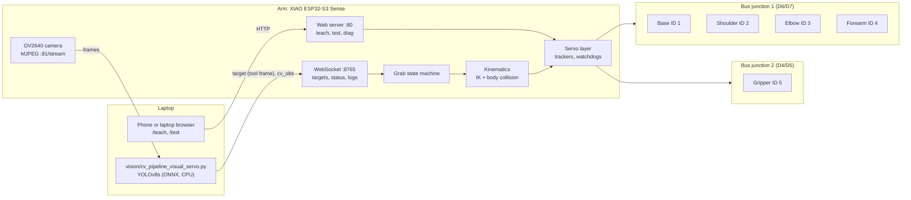

# System overview

| Layer | What | Where |
|---|---|---|
| Mechanics | 1 m, 2 kg arm worn on the back. Base: worm + 10:1 cycloid. Shoulder, elbow, forearm: HTD3M timing belts. Twist-lock gripper. All PETG. | [HARDWARE.md](HARDWARE.md), [BASE_GEARBOX.md](BASE_GEARBOX.md), [`cad/`](../cad) |
| Electronics | XIAO ESP32-S3 Sense, 5 × ST3215 on two resistor-spliced half-duplex buses, 3S LiPo, 5 V buck, 12 V cutoff switch | [HARDWARE.md](HARDWARE.md) |
| Firmware | header-only C++ on Arduino/ESP32: bus driver, multi-turn tracking, IK with a body model, teach mode, web pages, OTA | [FIRMWARE.md](FIRMWARE.md), [`firmware/`](../firmware) |
| Safety | arm gate, verified writes, watchdogs, E-STOP, body-collision IK, taught envelope | [SAFETY.md](SAFETY.md) |
| Testing | the real firmware compiled on a PC against a simulated servo bus, 940 checks | [TESTING.md](TESTING.md) |
| Vision | YOLOv8s on the laptop, calibrated monocular depth, targets over WebSocket | [VISION.md](VISION.md), [`vision/`](../vision) |

## Data flow for one autonomous grab

1. The camera streams frames to the laptop.
2. The pipeline detects the bottle, estimates its position relative to the grasp centre, and, when it has seen it in
   3 of the last 5 frames, sends a `target` with `frame:"tip"`.
3. The firmware converts the point into the arm frame with forward kinematics of the current pose.
4. The state machine moves to a point above the target, descends, closes the gripper until it feels contact (load),
   lifts, moves to the taught handoff pose, holds, releases and goes home.
5. Every move goes through IK (with the taught envelope and the body model) and the non-blocking servo layer, with the
   watchdogs running throughout.

Steps 1–3 run today in dry-run mode. Steps 4–5 run in the simulator; on the real arm they wait for a working base and
the 7 taught poses.
