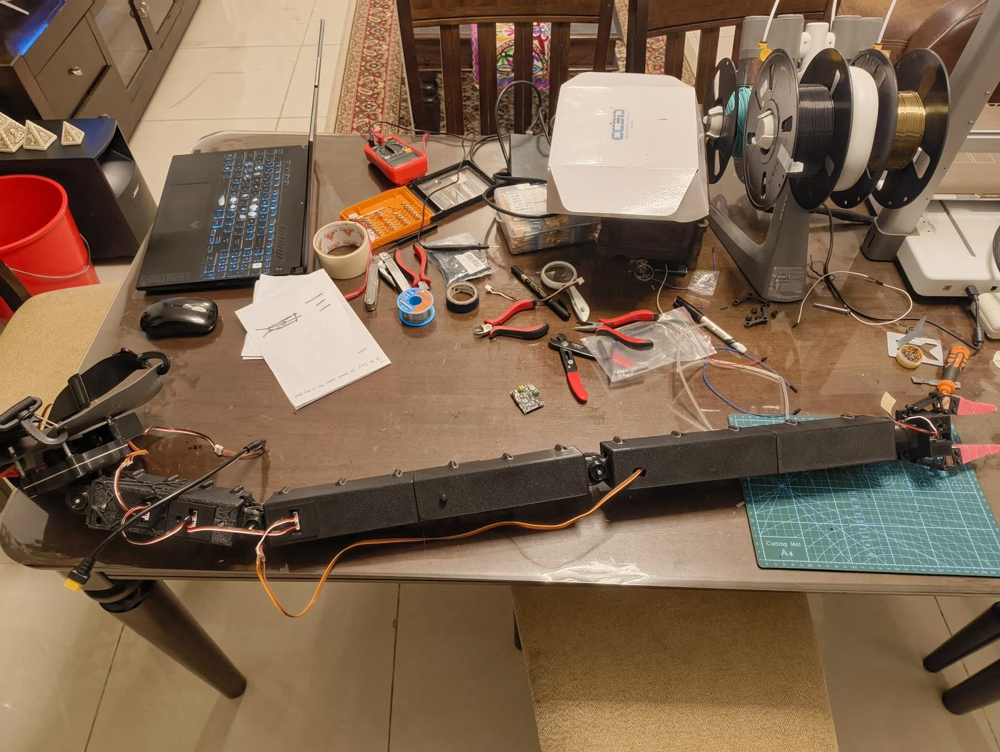
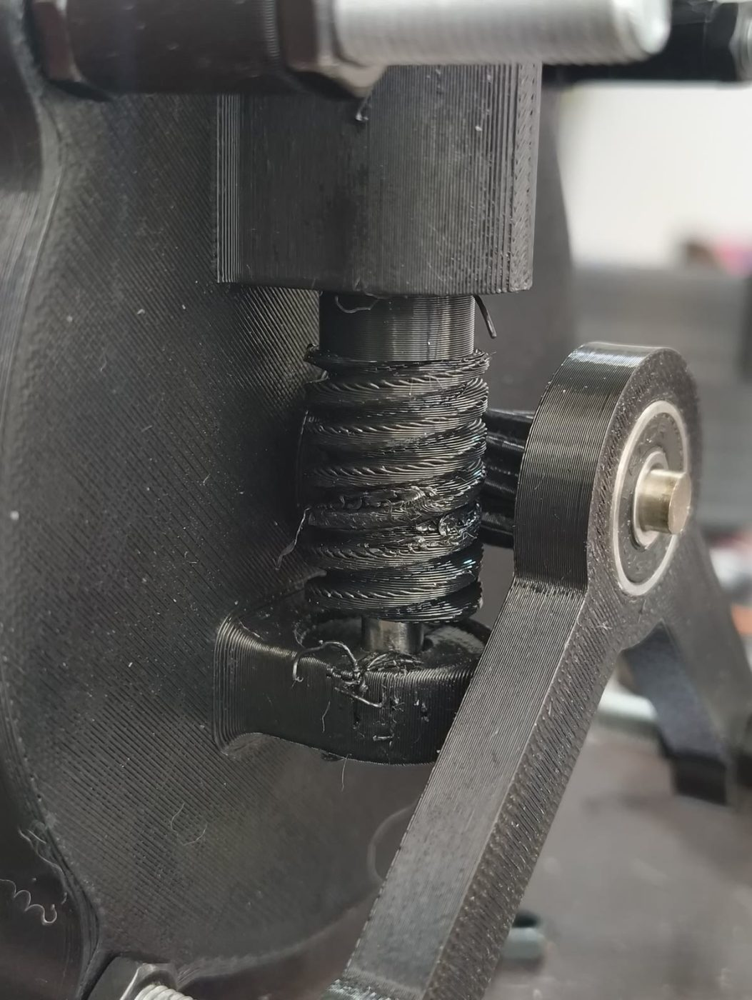
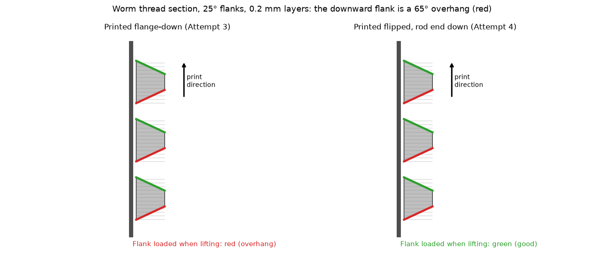
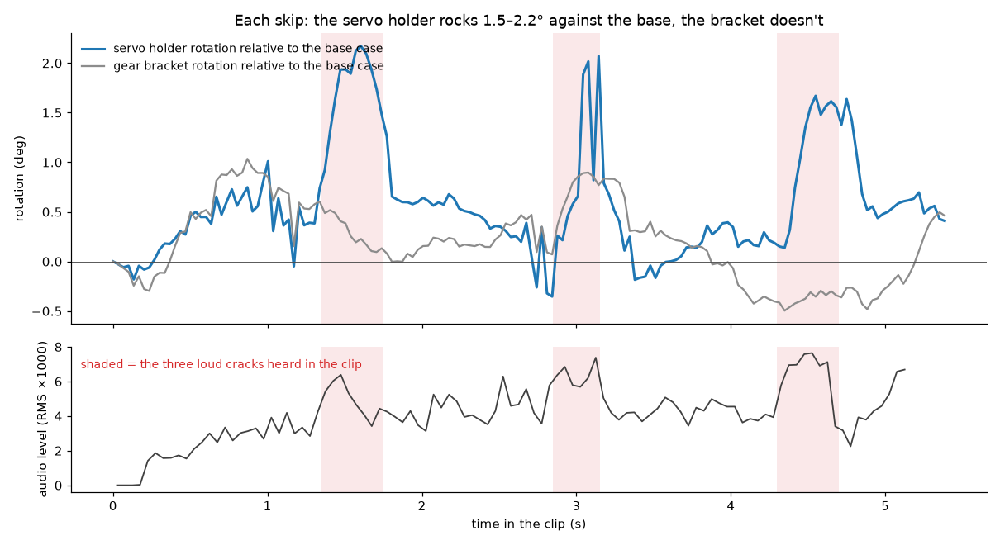
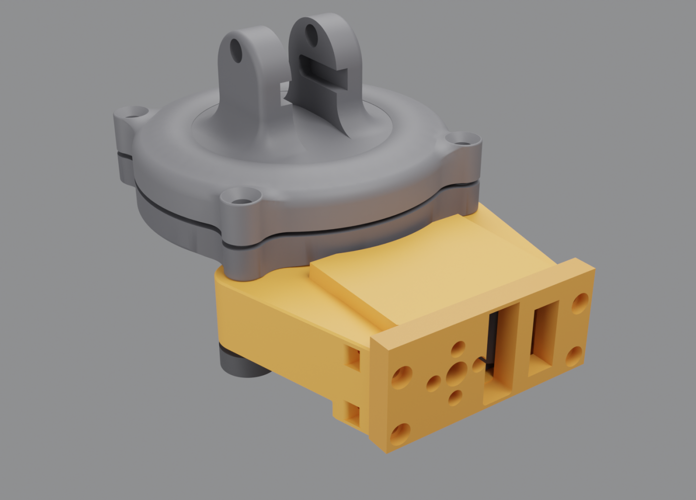
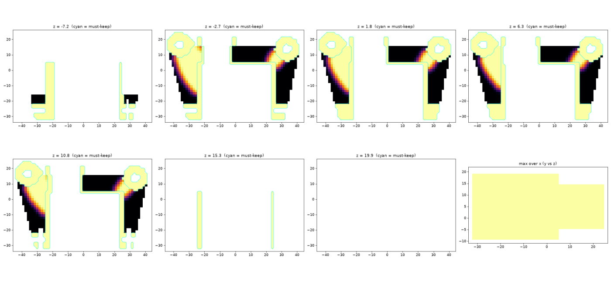
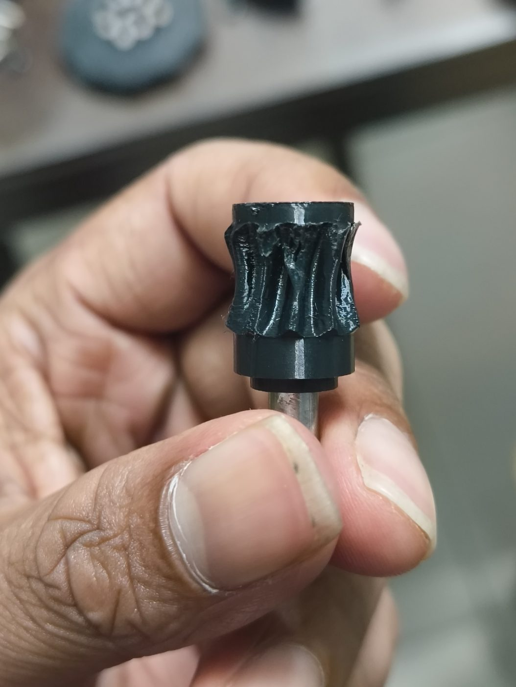

# The base gearbox

The base is the joint I spent the most time on, and it still isn't solved. This is the full story: what I built,
each way it failed, how I worked out why, and what I'd do next. The CAD for every stage is in
[`cad/v2/base_drive/`](../cad/v2/base_drive).



## Why the base is hard

The arm is about 1 m long and weighs about 2 kg, and it is worn on the back. The base axis sticks straight back out
of the shoulder blade, so the base does not just turn the arm: **it lifts and lowers the whole arm** sideways in the
plane of the back. With the arm straight out, gravity puts about **7.7 N·m** on the base (my estimate, from the CAD
volumes, 2 kg total and 60 g per servo).

One ST3215 gives about 2.9 N·m at stall on 12 V, so the base needs a big reduction. The drive is:

```
ST3215 servo → worm (on the servo horn) → worm gear (on a 5 mm steel rod) → 10:1 cycloidal reducer → arm
```

I chose a worm on purpose. A worm with a low lead angle **self-locks**: when torque is cut (E-STOP, an over-the-air
update, the 12 V switch), the arm holds instead of falling and spinning the servo backwards. Backdriving an ST3215
turns its motor into a generator, which can kill its driver board. That rule (never backdrive a servo) shapes a lot
of this design.

## Round 0: the original single-start worm (September)

The first stage was a single-start worm on a 20-tooth helical gear: 20:1, a 2.2° lead angle. I believed the
cycloid was 20:1 too.

**What I saw (Sep 30).** When I ran the base continuously from the new `/test` page, the worm spun but the helical gear
only moved "a couple of degrees per worm turn".

**What it actually was.** Not a fault. That is how a worm drive works: one tooth per thread per turn. My mistake was
in the design intent. I wanted the stage in front of the cycloid to *speed up* 5 to 10 times, and **no worm can step
up**; it is always a reduction. Combined with the cycloid, the base was absurdly slow.

I also learned that the ST3215's load register, in wheel mode, mostly tracks speed. I logged load against worm angle
over 7.2 worm turns at 30 %: flat at about 310, with no spike per turn. So the load register is not a torque or mesh
sensor, and I stopped using it to diagnose mesh problems.

## Round 1: a 4-start worm (Sep 30 to Oct 1)

To keep the self-locking worm but make the base faster, I went from 1 start to 4: 20:1 became **5:1**, with an 8.86°
lead angle (still self-locking for PETG on PETG, but with less margin). I kept the 11.55 mm centre distance, the
module (0.5), the tooth count, the horn flange and the rod bore, so it dropped into the existing case. I simulated
the mesh through a full worm revolution in 15° steps: no interference at any phase, minimum gap 0.046 mm.

**Result:** it still skipped under load, and the worm's thread crests flattened. At module 0.5 each crest was about
**0.42 mm thick, one extrusion line** from a 0.4 mm nozzle, and the working depth was only about 0.9 mm. Any 1 mm of
give in the mounting let the teeth jump.

## Round 2: a gear-tip support bracket (Oct 1)

A worm mesh pushes the worm and gear apart in proportion to the torque (here roughly 30 to 60 N). The gear was held by
one 625 bearing at its top, so its free bottom tip leaned away. I added a stub hub and a steel pin under the gear,
and a V-shaped bracket holding a second bearing under the tip, bolted to the case's front M5 rods.

**Result:** the gear stopped leaning, but the thin crests were still being crushed.

## Round 3: a 2-start worm with bigger teeth (Oct 2)

I doubled the tooth size: 2 starts and 10 teeth instead of 4 and 20, at module 1.0. That keeps 5:1, the 8.86° lead
and the centre distance. A 10-tooth gear undercuts badly at a 20° pressure angle, so I went to 25°.

| | 4-start | 2-start |
|---|---|---|
| Starts / teeth | 4 / 20 | 2 / 10 |
| Module | 0.5 | 1.0 |
| Pressure angle | 20° | 25° |
| Working depth | ~0.9 mm | 1.55 mm |
| Worm crest thickness | ~0.42 mm | ~0.87 mm |

**Result:** it skipped and shed bits at first, then ran. Then a clear pattern appeared: it skipped **only in the +
(lift) direction, at the damaged spot, and it was always the worm that broke, never the gear.**

### Diagnosis A: print orientation



My first guess was gravity, but I had run the test with the arm lying flat, where the load is the same both ways.
The close-ups showed horizontal layer lines: the worm had been printed standing up. Printed that way, each thread has
an upward flank that prints on the layer below (solid) and a **downward flank that is a 65° overhang**, printed mostly
in mid-air. In + the overhang flank carries the load and peels.



## Round 4: the same worm printed upside down (Oct 2)

Flipping the print makes the strong flank carry the lift. I also widened the screw pockets (Ø5.6 with a 7° guide
channel) because the driver was chewing the screw heads, and deepened the horn-screw hole. Printed at 0.08 mm layers,
the slicer flagged only 7 seconds of overhang wall on the whole part.

**Result:** the worm survived. Now the helical gear started breaking. Whichever part of the stage was weakest was
being destroyed, which told me something was still letting the teeth separate.

### Diagnosis B: the servo holder rocks at every skip

I filmed the base from the side while it skipped (5.4 s, handheld, with sound) and measured **relative rotation**
between parts, which cancels the camera's own movement: I tracked 150 feature points per region through all 162
frames with optical flow, fitted a rigid rotation per region per frame, and subtracted the case's rotation from the
holder's. Separately, I computed the audio loudness in 50 ms windows.



The holder rotates **1.5 to 2.2°** relative to the case at 1.5, 3.1 and 4.6 s, and the three loud cracks in the audio
fall at the same moments. The CAD explained why: the old holder didn't touch the case at all (a 2.1 mm gap). It hung
from two thin 8 × 8 mm arms clamped between nuts on threaded rods, with the servo 35 mm beyond the bolt line. A 2° tilt
moves the worm about a millimetre at the mesh, and the teeth only engage 1.55 mm.

## Round 5: a new servo holder, lightened with my own FEA (Oct 2)

The case's ear undersides and its floor are one flat plane, so the new holder clamps **flat against the case**
(about 920 mm² of contact instead of none), with Ø16 bosses bearing directly on the ears, full-depth side wings,
cheeks hugging the worm cradle, and a 7 mm back plate.



No FEA package was installed, so I wrote one in Python: voxelised the holder at 1.5 mm (13,198 voxels, within 0.1 % of
the CAD volume), 8-node brick elements, PETG E = 2000 MPa, an algebraic-multigrid preconditioned solver. I validated it
on a bar in tension (within 2 % of FL/EA). I worked the loads out from the arm: about 200 N of axial thrust on the
worm and 88 to 94 N sideways and radial, in four load cases. Then I ran a SIMP topology optimisation (keep 30 % of the
free material, maximise stiffness) and turned its answer into three printable pockets.



| | Solid | Lightened |
|---|---|---|
| Volume | 44.5 cm³ | 38.1 cm³ (−14 %) |
| Worm-end movement, worst case | 5.3 µm | 6.5 µm |
| Peak von Mises, 200 N lift | 0.96 MPa | 1.10 MPa |

6.5 µm of movement is more than 200 times smaller than the 1.55 mm of tooth engagement. Limits: linear, static,
idealised contacts, voxel stair-steps, no creep.

## Round 6: a throated worm wheel (Oct 3)

With the holder solid, I wanted more teeth sharing the load. I generated a **throated** (enveloping) 10-tooth wheel by
simulating the worm cutting it, slice by slice in 2D, then checked it with FEA: about **2× stronger** than the straight
helical. The cycloid ratio mattered for the margin, so I counted it: 10 lobes and 11 pins, **10:1** (not the 20:1 I had
assumed). The base total became 5 × 10 = 50.

**Result:** it pushed through a real hand load on the bench for the first time (Oct 3, evening). Then it broke when
loaded again, and I could see the parts separate.

**Why:** a throated wheel only works if its curved throat stays centred on the worm, and I found that nothing held the
gear along its own axis. I added printed thrust washers (0.5 to 2.0 mm, to shim the stack) and, on Oct 4, a bracket
that grips all four case legs instead of two. FEA showed the four-arm bracket was much stiffer than the V bracket but
still flexed too much along the gear's axis, the direction that matters for a throated gear. **It failed too.**



## Round 7: a face gear (Oct 4 to 6)

A face gear driven by the same worm turns the separating force from sideways (about 90 N) into **along the gear's
axis** (about 9 N sideways plus friction), which the bearing stack can take. It is a straight reprint: same worm v2,
holder, rod, pin and washers, no cutting of the case. It has 20 teeth, so the stage is 10:1 and the base total 100.
I generated it the same way (simulated hobbing), with tooth strength about the same as the throated wheel's (safety
factor about 0.9 with the arm straight out); the gain is robustness, not strength.

- **First print:** sheared the tooth tips. There was a 0.5 to 1 mm gap under the gear, and the mesh force always pushes
  a face gear down, away from the worm.
- **Fixed the gap: it worked** (Oct 4), holding in the exact pose that broke the throated wheel.
- **Then the cycloid misbehaved:** about 20° of output play, and intermittent lock-ups while the input spun freely.
  The two cams were each pinned to the rod by their own loose, partly inserted pen nib, so they slipped and drifted out
  of their 180° phase, and the two discs fought each other. I redesigned them as **one printed double cam** pinned
  once. While doing that I also found cycloid 1's bearing hole had worn oval, so I reprinted both discs.
- **Face gear v2** (Oct 5): v1's 45° rim flare curled up in PETG. v2 has a straight rim and no overhangs, with identical
  teeth.
- **Oct 6:** the face gear broke while lifting the arm, even with no gap under it, a 2 mm washer and the stack
  tightened hard. With the competition the next day, I stopped working on the base and demonstrated the other four
  joints.

## Where it stands

The base drives, holds and lifts a light load, but not the full arm reliably. Every printed gear stage I tried was
either too weak in its teeth or let the teeth separate. What I'd do next, in order:

1. **Counterbalance the arm** (a spring or elastic band from the back plate) so the base carries far less than 7.7 N·m.
   This attacks the cause instead of the symptom.
2. **Move the reduction ahead of the printed parts**: a metal worm set, or a bought planetary stage, so the printed
   gears see less torque.
3. Keep the self-locking requirement, or replace it with a brake, because torque cuts must never drop the arm.

The firmware side is ready for whichever drive I end up with: the base ratio, backlash and torque limit are editable
at runtime, and `baseCapTick()` steps the base speed down when it nears its torque limit (see
[FIRMWARE.md](FIRMWARE.md)).
