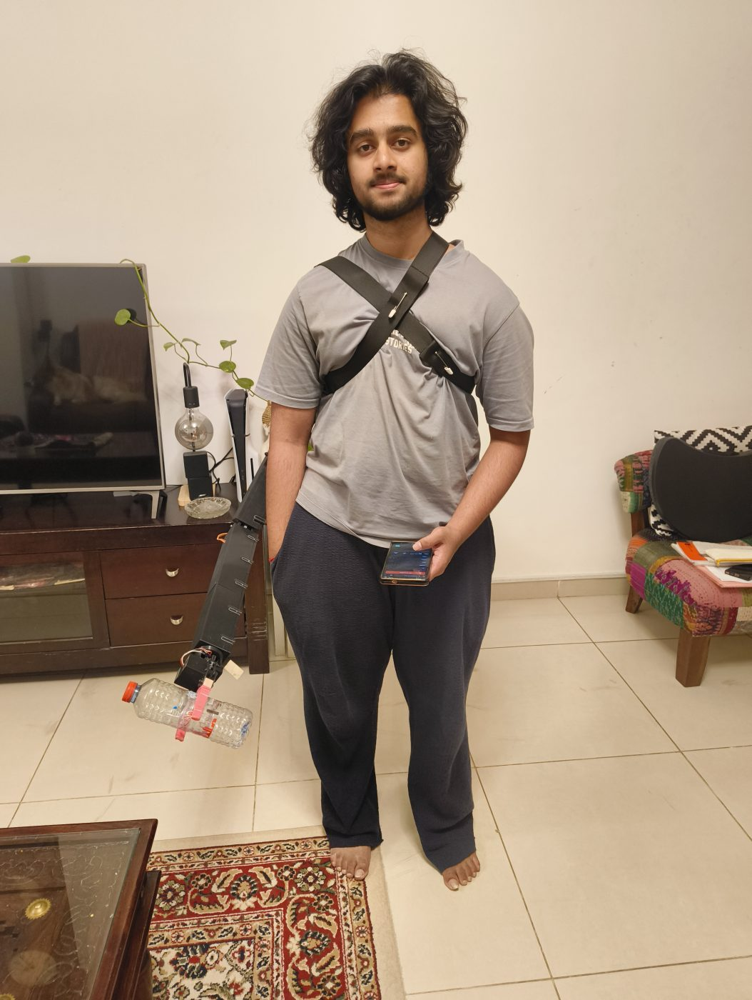

# Hardware (V2)



## The arm

A 4-joint arm plus a gripper, worn on a back plate behind the right shoulder blade. About 1 m long and 2 kg.

| Joint | Servo ID | Drive | Ratio |
|---|---|---|---|
| Base | 1 | worm + gear stage, then a 10:1 cycloidal reducer (see [BASE_GEARBOX.md](BASE_GEARBOX.md)) | 50 to 100 (depends on the worm stage) |
| Shoulder | 2 | two HTD3M timing-belt stages, 16→40 and 15→40 | 6.667 |
| Elbow | 3 | two HTD3M belt stages, 16→40 and 15→36 | 6.0 |
| Forearm (wrist pitch) | 4 | HTD3M belt, 16→16 transfer then 16→36 | 2.25 |
| Gripper | 5 | servo-driven sector gears opening and closing two jaws, balloon-covered fingertips for grip | 1 |

Link lengths from the CAD: shoulder to elbow 189.2 mm, elbow to wrist 400 mm, wrist to grasp centre about 475 mm.
The gripper twist-locks onto the forearm, so it can come off by hand.

All structural parts are printed in PETG on a Bambu Lab A1 with a 0.4 mm nozzle. The CAD is in [`cad/v2/`](../cad/v2).

## Electronics

| Part | Qty | Notes |
|---|---|---|
| Seeed Studio XIAO ESP32-S3 Sense | 1 | the only computer on the arm: servos, camera, Wi-Fi, web pages. OPI PSRAM holds the camera frames. |
| OV2640 camera (on the XIAO Sense board) | 1 | mounted at the gripper |
| Feetech/Waveshare ST3215 serial bus servo, 12 V | 5 | position feedback, 4096 steps per turn, readable load/voltage/temperature, ~2.9 N·m stall |
| 3S LiPo, 11.1 V, 4200 mAh, 35C | 1 | runs everything |
| DC-DC buck converter to 5 V | 1 | feeds the XIAO's 5 V pin |
| Resistors: 300 Ω and 10 kΩ | 2 of each | one pair per bus junction (below) |
| Physical cutoff switch on the 12 V rail | 1 | the primary emergency stop |

**Bus wiring.** The servos share one half-duplex data wire. I splice the ESP32 onto it with two resistors instead of a
driver board:

```
XIAO TX ──[300 Ω]──┐
                   ├── node ── servo data wire(s)
XIAO RX ──[10 kΩ]──┘
```

TX idles high through its 300 Ω, so the line needs no pull-up. One junction drives at most four servos (measured), so
there are two: the four joints on D6/D7 (`Serial1`) and the gripper on D4/D5 (`Serial2`). Every ground is common.
The junctions are insulated in hot glue, and the 12 V leads are soldered (Dupont connectors on the power leads came
loose during the first wear test).

**Power notes I learned the hard way.**
- The XIAO is powered with 5 V into its **5V/VUSB pin**. Its 3V3 pin is a regulator *output*; feeding it did nothing.
- A powered-down servo board connected to the XIAO's TX/RX can stop the XIAO from booting.

## Mechanical hardware

| Part | Used for |
|---|---|
| HTD3M timing belts and printed pulleys | shoulder, elbow and forearm drives |
| 625-2RS bearings | base gear support |
| 10 mm ID bearings | inside the cycloidal discs |
| 5 mm steel rod | the base's input shaft, through the worm gear and cams |
| M5 threaded rods and nuts | hold the base stack together and carry the servo holder |
| M3 / M2.5 screws | servo horn, back plate, covers |
| Back plate and harness straps | mount the arm on the body |

## Cost

<!-- ASK: total cost and per-part prices for V2 (in AED or USD). -->
To be added: a full cost breakdown compared with commercial powered arms.
