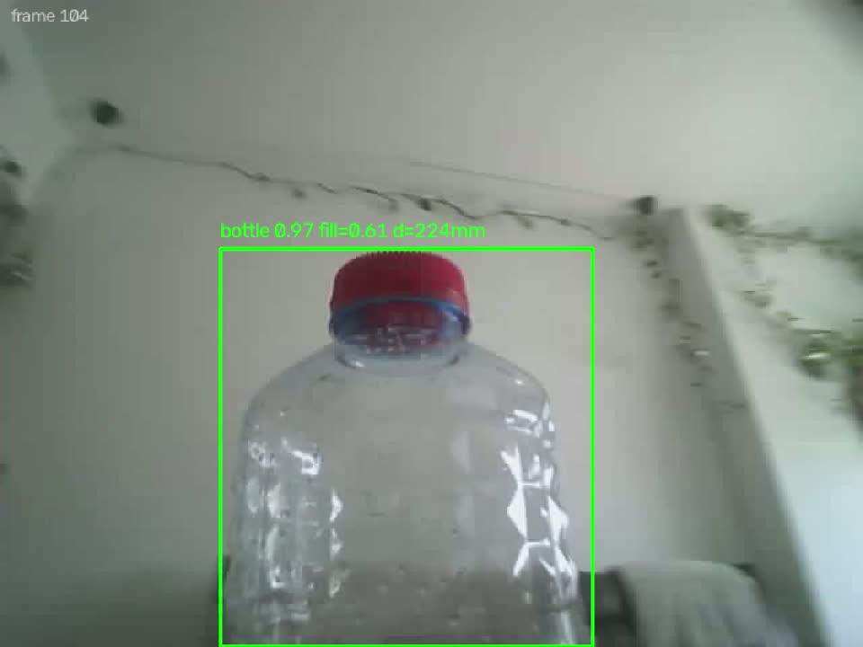

# Computer vision

The camera is in the gripper. The idea: the arm sees an object, works out where it is in 3D, and reaches for it.



## How it works

1. The XIAO ESP32-S3 Sense streams MJPEG (640×480) from its OV2640 camera on port 81.
2. On the laptop, [`vision/cv_pipeline_visual_servo.py`](../vision/cv_pipeline_visual_servo.py) decodes each frame
   and runs YOLOv8s with ONNX Runtime on the CPU (about 60 ms a frame; the camera delivers a frame every ~86 ms, so the
   camera, not the model, is the limit).
3. From the detection's box it estimates depth (how full the box is, calibrated against a tape measure) and the
   direction to the object, and turns that into a point relative to the gripper's grasp centre.
4. It sends the point to the arm over WebSocket as a `target` in the tool frame (`"frame":"tip"`). The firmware converts
   it to the arm frame with forward kinematics and runs IK.

**Why the laptop and not the arm or my phone.** The ESP32 can't run a detector at a useful rate. I first planned to run
it on my phone (it would be in my pocket anyway), but my phone's hotspot isolates its clients, so the phone couldn't
reach the arm. The laptop joins the arm's own access point and gets internet from the phone over USB.

## Safety

- **Dry run by default.** Without `--auto` the pipeline only reports what it sees (`cv_obs`, about 5 Hz). The `/test`
  page shows the detection, the 3D point and the IK verdict for both the target and the approach point, using the same
  IK function as the grab state machine. It never moves the arm.
- In `--auto`, a target is sent only when the object is seen in 3 of the last 5 frames (median position). The firmware
  also requires confidence ≥ 0.60.
- If the WebSocket drops in `--auto`, the pipeline exits instead of reconnecting: the firmware cancels auto mode and
  homes on a disconnect, and the pipeline must never quietly switch it back on.

## Findings

**The bottle is a vase.** My green demo bottle was detected for a split second at a time. Testing on camera-like images
showed YOLO labels it "vase" (0.84) far more often than "bottle" (0.14). The pipeline now accepts bottle, vase and wine
glass. In one live run that took detection from flickering to 76 % of frames.

**Model choice.** I compared yolov8n/s/m, yolo11s/m, yolo26s/m and YOLO-World v2 on camera-like test images and chose
**YOLOv8s exported at 480×640**, the camera's own aspect. No model detects a bottle that overflows the frame, which is
fine because the grab state machine takes its target once, while scanning, with the whole bottle in view. Clear plastic
bottles are weak on every model, mostly because of JPEG compression and blur.

**A frame-counting bug.** `get_frame()` used to return the same frame repeatedly, inflating the frame rate and detection
percentage and letting one frame count several times. Each frame is now processed once.

## Calibration

I calibrated against tape measurements with the green bottle (295 mm tall): recordings at several known distances and
side offsets, averaged over 3 s each with the **Record** button on `/test`.

| Value | Before | After |
|---|---|---|
| Depth model | 66 | 138 (fill × distance) |
| Focal length | 614 / 626 px | 360 px (the lens is ~83° wide, not ~55°) |
| Optical centre x | 320 | 290 |
| Camera tilt | 15° down (assumed) | 19° **up** (measured) |
| Lens offset from grasp centre | not modelled | 72 mm back, 25 mm up |
| **RMS error, fwd / left / up** | **170 / 32 / 87 mm** | **32 / 16 / 18 mm** |

The depth calibration only holds for this bottle; other objects need their own.

## Status

Detection works live and finds the bottle at about 1 m. Proof footage: the pipeline drew a stable green box on the
bottle at up to 0.90 confidence (`vision/cv_capture_agent.py` records it). **The arm has not yet done a CV-driven grab.**
That needs the 7 taught poses, which need a working base. The next test is to hold a bottle still, jog one joint at a
time, and check the computed point stays within ±15 mm; drift shows which gear ratio, sign or offset is wrong.

## Running it

```bash
cd vision
python3 -m venv .venv && .venv/bin/pip install -r requirements.txt
.venv/bin/python cv_pipeline_visual_servo.py \
    --cam http://192.168.4.1:81/stream --arm ws://192.168.4.1:8765 --preview
```

In the preview, the green box is the target and the grey box is the strongest non-target class (it shows what a missed
object is being read as). `s` saves the raw frame, `q` quits. Flags: `--conf`, `--classes`, `--model`, `--grip-dist`,
`--grip-fill`, `--tilt`. Never pass `--auto` until the gear ratios are measured and the 7 poses are taught.
